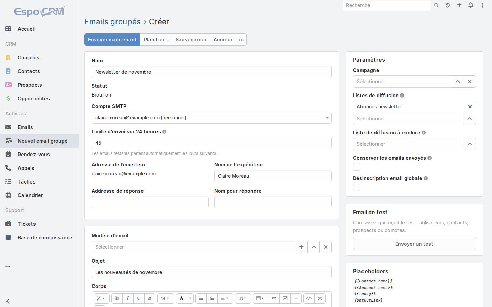
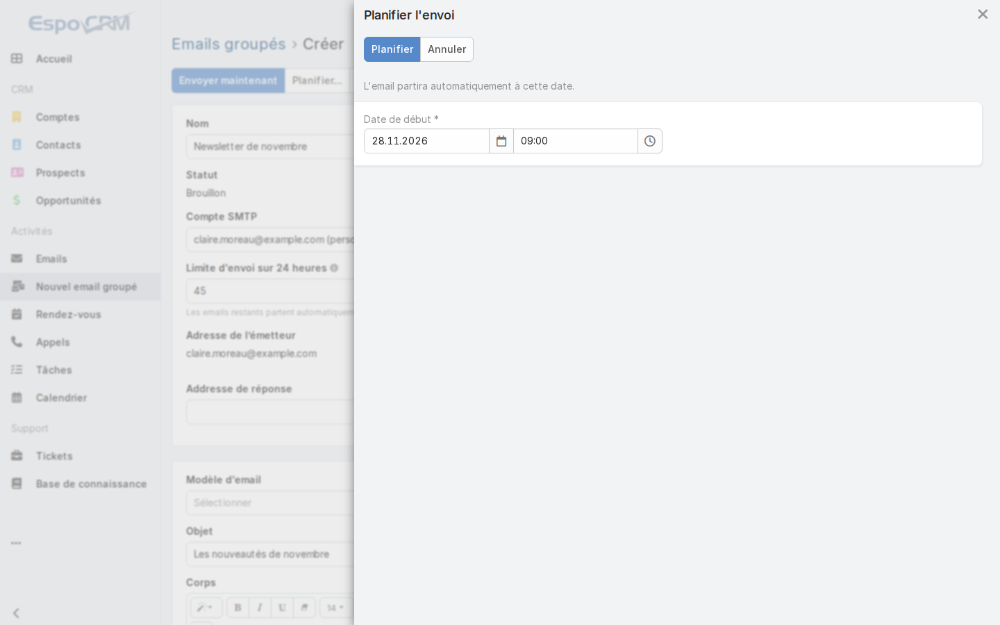
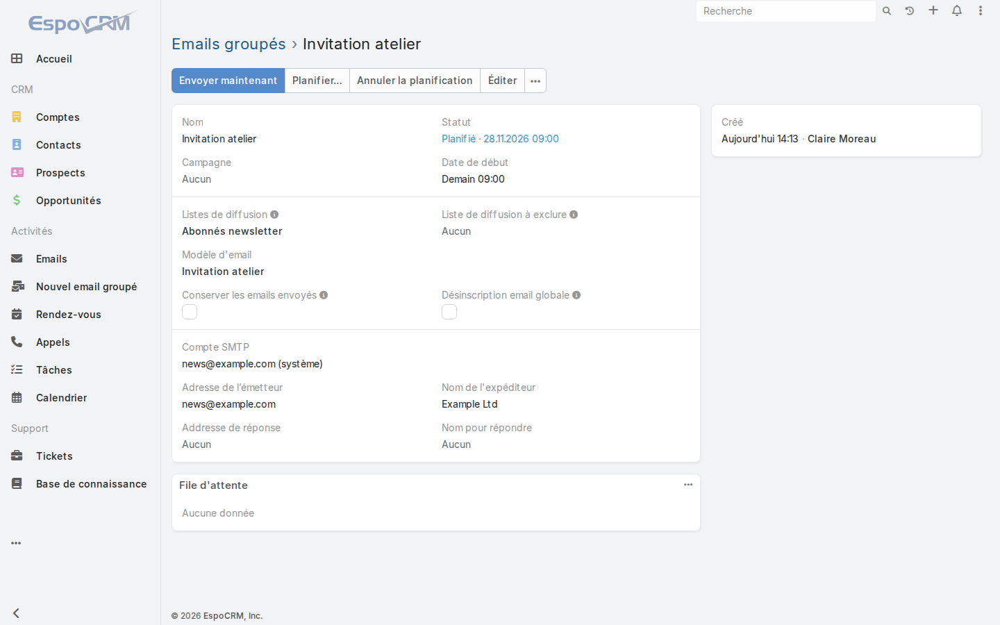
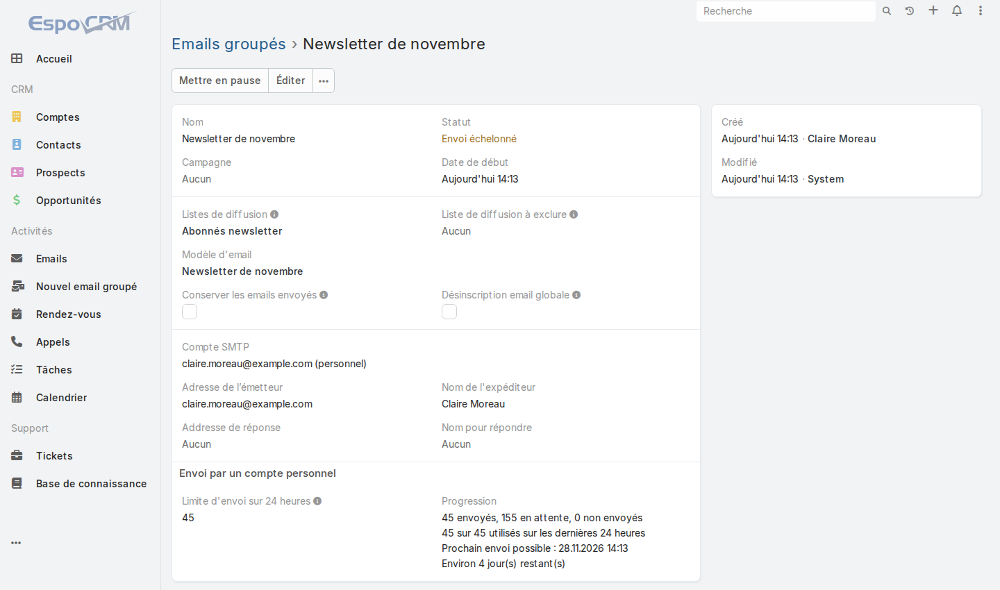

# Simple Mass Email

Extension EspoCRM pour rédiger, tester et envoyer un email groupé depuis un seul écran. Vous pouvez l'envoyer tout de suite ou le planifier, depuis le SMTP de l'entreprise ou depuis votre propre boîte mail avec une limite d'envoi par 24 heures.

## Ce que l'extension change

Dans EspoCRM, un email groupé (Mass Email) se prépare depuis une campagne : il faut créer un modèle d'email à part, puis régler un statut et une date de début, et attendre le passage du planificateur. L'envoi part alors aussi vite que le permet le plafond horaire réglé par l'administrateur, depuis le SMTP du système ou d'un compte de groupe : il n'y a pas de limite par jour ni d'envoi depuis votre propre boîte mail.

Avec Simple Mass Email :

- **Une entrée « Nouvel email groupé »** dans la barre latérale ouvre directement le formulaire.
- **L'objet et le corps s'écrivent dans le formulaire**, sans passer par un modèle d'email. Vous pouvez aussi partir d'un modèle existant, qui n'est jamais modifié.
- **Deux boutons pour envoyer** : « Envoyer maintenant », qui démarre dans la minute, ou « Planifier… », pour choisir la date et l'heure.
- **L'envoi peut partir de votre boîte mail** (compte email personnel), avec une limite par 24 heures : sur 200 contacts avec une limite de 45, l'envoi s'étale sur 5 jours, tout seul.
- **La fiche suit l'envoi** : envoyés, en attente, prochain envoi possible. Vous pouvez mettre en pause, reprendre ou annuler une planification.

## Fonctionnalités

### Envoyer maintenant ou planifier

« Envoyer maintenant » lance l'envoi dans la minute. « Planifier… » ouvre une fenêtre qui demande la date et l'heure, par défaut le lendemain à 9 h. Le statut et la date de début ne se règlent plus à la main.

La fiche affiche l'état de l'email groupé et les actions possibles :

| État | Statut affiché | Boutons |
| --- | --- | --- |
| Brouillon | Brouillon | Envoyer maintenant, Planifier… |
| Planifié | Planifié · date | Envoyer maintenant, Planifier…, Annuler la planification |
| En cours | Envoi en cours, ou Envoi échelonné pour un compte personnel | Mettre en pause |
| Suspendu | Échec | Reprendre l'envoi |

Mettre en pause ou annuler une planification repasse l'email en brouillon. Un nouvel envoi reprend avec les destinataires restants, sans écrire deux fois à la même personne.

### Envoi depuis votre boîte mail, avec une limite

Le champ « Compte SMTP » propose, en plus du SMTP du système et des comptes de groupe, vos comptes email personnels (ceux dont le SMTP est configuré). Choisissez-en un, puis indiquez la limite d'envoi sur 24 heures (45 par défaut) :

- l'email part de votre adresse ;
- la limite s'applique **à votre compte**, tous emails groupés et tests confondus, sur 24 heures glissantes, quelle que soit la façon dont votre fournisseur compte ses journées ;
- les emails restants partent automatiquement les jours suivants ;
- un contact qui se désinscrit pendant l'envoi ne reçoit pas les emails prévus les jours suivants.

Si votre serveur SMTP refuse les emails à répétition, ou si le compte n'est plus utilisable, l'envoi est suspendu et vous recevez une notification. « Reprendre l'envoi » repart avec les contacts restants.

Seul le propriétaire du compte peut l'utiliser ou modifier l'email groupé qui s'en sert, administrateurs compris. Les autres personnes autorisées à modifier l'email groupé peuvent seulement l'arrêter.

### Email de test

« Envoyer un test » ouvre la fenêtre de test d'EspoCRM : vous choisissez les destinataires parmi les utilisateurs, contacts, prospects et comptes. Avec un compte personnel, le test part de ce compte et compte dans sa limite.

### Lien de désinscription

Comme dans EspoCRM, un lien de désinscription est ajouté en bas de l'email si le corps n'en contient pas (`{optOutLink}`), sauf si l'administrateur a désactivé ce lien obligatoire ou pour une campagne de type « informatif ». Avec un compte personnel, le lien est toujours ajouté, et les campagnes de type « informatif » sont refusées.

### Campagne

Une campagne n'est pas nécessaire. Un rôle qui ne peut modifier que ses propres campagnes doit cependant en choisir une (sans campagne, EspoCRM refuse la création à ce rôle). Le formulaire l'indique et ne propose que ses campagnes.

## Installation

1. Téléchargez `simple-mass-email-x.y.z.zip` depuis la [dernière version](https://github.com/AlexisSantin/espocrm-simple-mass-email/releases/latest).
2. Dans EspoCRM : Administration → Extensions → choisir le fichier → Installer.

L'installation ajoute « Nouvel email groupé » dans la barre latérale, juste après « Emails », et planifie la tâche d'envoi chaque minute. Pour mettre à jour, installez la nouvelle version par-dessus la précédente.

## Prérequis

- EspoCRM 10.0.3 ou plus récent (testé sur 10.0.11 et 10.1.1), PHP 8.3 ou plus récent.
- Le cron d'EspoCRM doit tourner chaque minute, comme EspoCRM le recommande : c'est lui qui lance les envois.
- Envoi par le système : une adresse d'envoi configurée dans Administration → Emails sortants, avec son compte SMTP.
- Envoi par un compte personnel : un compte email personnel actif, avec son SMTP configuré, et un rôle qui autorise les comptes personnels.
- Les utilisateurs non administrateurs doivent pouvoir créer des modèles d'email et lire et modifier les leurs : l'objet et le corps y sont enregistrés.

## Bon à savoir

- Avec un compte personnel, les emails d'un lot partent à la suite, lors d'un même passage du cron. Ils n'apparaissent pas dans le dossier « Envoyés » de votre boîte mail. Vos emails écrits à côté ne sont pas décomptés : gardez une marge sous la limite de votre fournisseur.
- La liste des destinataires est figée au premier envoi : les contacts ajoutés ensuite aux listes de diffusion ne sont pas inclus.
- Si vous désinstallez l'extension pendant un envoi, cet envoi reste en suspens : les emails groupés en cours ou planifiés ne partent plus.
- L'entrée de la barre latérale est ajoutée à la liste d'onglets du système. Les utilisateurs qui ont leur propre liste (Préférences) peuvent l'ajouter eux-mêmes : onglet de type URL vers `#MassEmail/create`.
- Le lien de la barre latérale suit le droit de lecture sur les campagnes : un utilisateur qui peut les lire sans pouvoir les modifier voit le lien, mais EspoCRM refuse la création.

## Fonctionnement technique

- Le module `SimpleMassEmail` remplace les vues natives de l'email groupé (`metadata/clientDefs/MassEmail.json`) : `recordViews.edit` pour le formulaire en deux colonnes, `recordViews.detail` pour la fiche et ses boutons d'envoi.
- L'objet et le corps sont enregistrés dans un modèle d'email interne, marqué `oneOff`, assigné à son auteur avec son équipe par défaut et lié par `emailTemplateId`. Un modèle partagé n'est jamais modifié : s'il est changé dans le formulaire, une copie privée est créée.
- Envoyer ou planifier enregistre le statut `Pending`, avec la date choisie, ou une date vide pour « maintenant ». À chaque sauvegarde, API comprise, le hook `SendingStatus` le remplace par `Sending` (« Envoi en cours », SMTP système ou de groupe) ou `Throttled` (« Envoi échelonné », compte personnel), et une date vide devient l'heure de la sauvegarde.
- Ces deux statuts tiennent l'email groupé à l'écart de la tâche native `ProcessMassEmail`. La tâche `SimpleMassEmailSendPersonal`, planifiée chaque minute, les envoie à leur date avec le `SendingProcessor` d'EspoCRM : lien et en-têtes de désinscription, suivi de campagne, limite horaire `massEmailMaxPerHourCount`. Les deux tâches n'envoient donc jamais le même email groupé, et une désinstallation ne peut pas déclencher un envoi massif d'un coup.
- Pour un compte personnel, le `SendingProcessor` reçoit le SMTP du compte et envoie un email à la fois, après vérification de la limite. Les envois sont notés dans l'entité interne `SimpleMassEmailSend`, qui survit à la suppression d'un email groupé. Le lien de désinscription est imposé (`massEmailDisableMandatoryOptOutLink` ignoré).
- Le module est livré en bundle : `lib/init.js` est déclaré dans `metadata/app/client.json` (`scriptList`).
- `scripts/AfterInstall.php` ajoute l'entrée de la barre latérale (lien `#MassEmail/create`, `aclScope` = `MassEmail`) après « Emails », planifie la tâche d'envoi et assigne à leur auteur les modèles internes créés sans utilisateur assigné. Le paramètre `simpleMassEmailTabAdded` évite de remettre un lien que l'administrateur a retiré. `scripts/AfterUninstall.php` retire le lien et la tâche.

## Licence

Copyright (C) 2026 Alexis SANTIN.

Simple Mass Email est un logiciel libre, publié sous la [GNU Affero General Public License v3.0 ou ultérieure](LICENSE), la même licence qu'EspoCRM.
