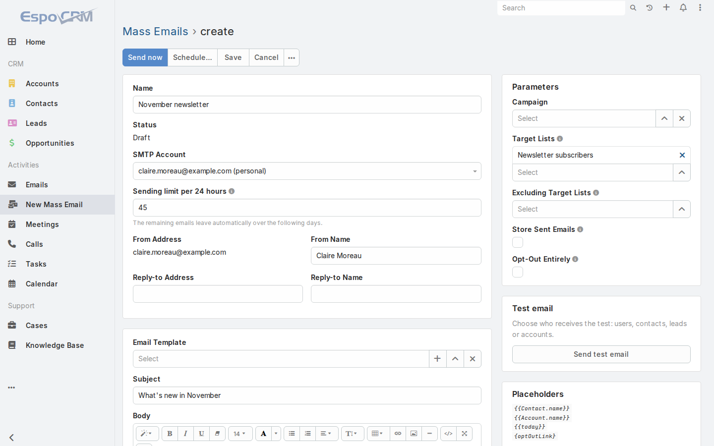
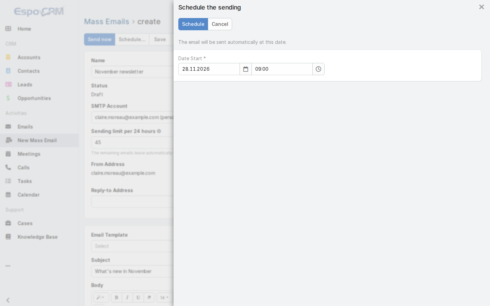
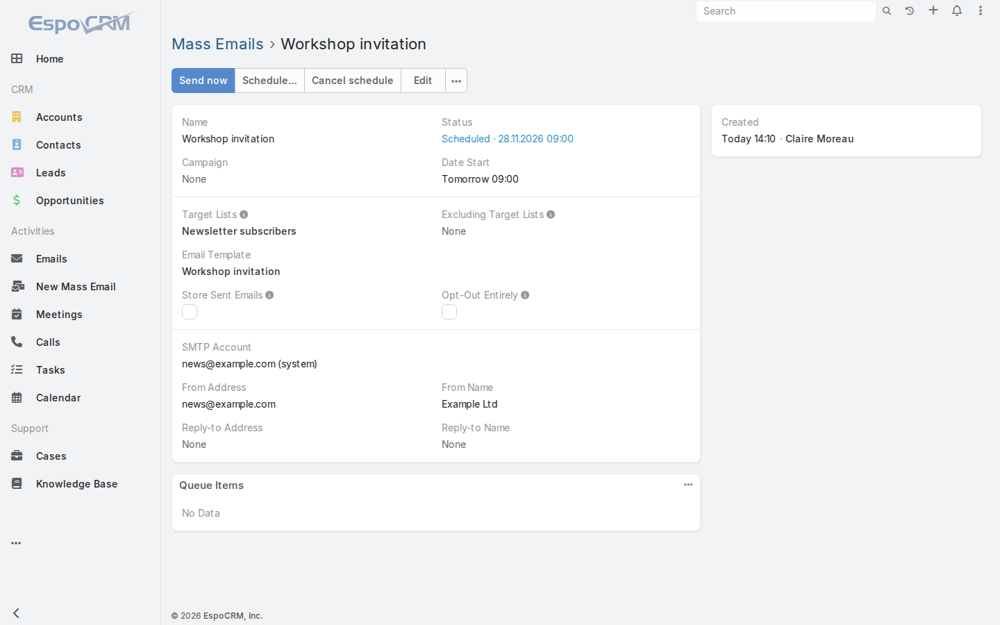
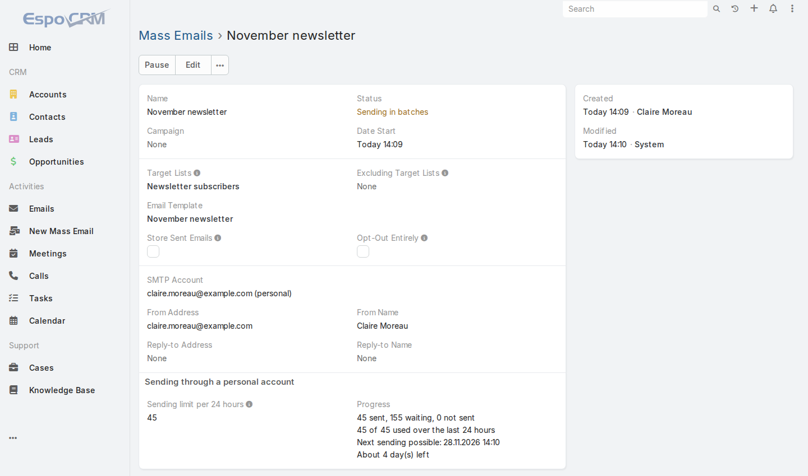

# Simple Mass Email

An EspoCRM extension to write, test and send a mass email from one screen. Send it now or schedule it, through the company's SMTP or from your own mailbox with a sending limit per 24 hours.

## What it changes

In EspoCRM, a mass email is prepared from a campaign: you create an email template on the side, set a status and a start date, then wait for the scheduler. The emails then leave as fast as the hourly limit set by the administrator allows, through the system or a group email account: there is no daily limit and no sending from your own mailbox.

With Simple Mass Email:

- **A "New Mass Email" entry** in the side menu opens the form directly.
- **Subject and body are written in the form**, without a separate email template. You can also start from an existing template, which is never modified.
- **Two buttons to send**: "Send now", which starts within a minute, or "Schedule…", to pick the date and time.
- **Sending can leave from your own mailbox** (personal email account), with a limit per 24 hours: 200 contacts with a limit of 45 are sent over 5 days, on their own.
- **The record follows the sending**: sent, waiting, next possible sending. You can pause, resume or cancel a schedule.

## Features

### Send now or schedule

"Send now" starts the sending within a minute. "Schedule…" opens a window asking for the date and time, tomorrow at 9:00 by default. The status and the start date are no longer edited by hand.

The record shows the state of the mass email and the available actions:

| State | Status shown | Buttons |
| --- | --- | --- |
| Draft | Draft | Send now, Schedule… |
| Scheduled | Scheduled · date | Send now, Schedule…, Cancel schedule |
| Running | Sending, or Sending in batches for a personal account | Pause |
| Suspended | Failed | Resume sending |

Pausing or cancelling a schedule puts the mass email back to draft. Sending it again resumes with the remaining recipients, without writing twice to the same person.

### Sending from your own mailbox, with a limit

Besides the system SMTP and the group accounts, the "SMTP Account" field lists your personal email accounts (those with an SMTP server set up). Pick one, then set the sending limit per 24 hours (45 by default):

- the email leaves from your address;
- the limit applies **to your account**, across all mass emails and tests, over any 24 hours, whatever way your provider counts a day;
- the remaining emails leave automatically on the following days;
- a contact who unsubscribes during the sending does not get the emails planned for the following days.

If your SMTP server keeps refusing the emails, or the account can no longer be used, the sending is suspended and you get a notification. "Resume sending" goes on with the remaining contacts.

Only the owner of the account can use it or change the mass email that uses it, administrators included. Other people allowed to edit the mass email can only stop it.

### Test email

"Send test email" opens EspoCRM's test window: you choose the recipients among users, contacts, leads and accounts. With a personal account, the test leaves from that account and counts towards its limit.

### Unsubscribe link

As in EspoCRM, an unsubscribe link is added at the bottom of the email when the body has none (`{optOutLink}`), unless the administrator turned this mandatory link off or the campaign is of the "Informational Email" type. With a personal account, the link is always added, and informational campaigns are refused.

### Campaign

A campaign is not required. A role that can only edit its own campaigns must however pick one (without a campaign, EspoCRM refuses the creation to such a role). The form says so and only offers that user's campaigns.

## Installation

1. Download `simple-mass-email-x.y.z.zip` from the [latest release](https://github.com/AlexisSantin/espocrm-simple-mass-email/releases/latest).
2. In EspoCRM: Administration → Extensions → choose the file → Install.

The installation adds "New Mass Email" to the side menu, right after "Emails", and schedules the sending job every minute. To update, install the new version over the previous one.

## Requirements

- EspoCRM 10.0.3 or later (tested on 10.0.11 and 10.1.1), PHP 8.3 or later.
- EspoCRM's cron must run every minute, as EspoCRM recommends: it starts the sendings.
- Sending through the system: an outbound address set up in Administration → Outbound Emails, with its SMTP account.
- Sending through a personal account: an active personal email account with its SMTP set up, and a role that allows personal email accounts.
- Non-admin users must be able to create email templates and to read and edit their own: the subject and body are stored in one.

The interface is available in English and French.

## Good to know

- With a personal account, the emails of a batch leave one after the other, during one run of the cron. They do not appear in the "Sent" folder of your mailbox. Emails you write besides are not counted: keep a margin below your provider's limit.
- The recipient list is set when the sending starts: contacts added to the target lists afterwards are not included.
- If you uninstall the extension during a sending, that sending stays on hold: mass emails being sent or scheduled no longer leave.
- The side menu entry is added to the system tab list. Users with their own tab list (Preferences) can add it themselves: a URL tab to `#MassEmail/create`.
- The side menu link follows the read access to campaigns: a user who can read campaigns but not edit them sees the link, but EspoCRM refuses the creation.

## How it works

- The `SimpleMassEmail` module replaces the native mass email views (`metadata/clientDefs/MassEmail.json`): `recordViews.edit` for the two-column form, `recordViews.detail` for the record and its sending buttons.
- The subject and body are stored in an internal email template, flagged `oneOff`, assigned to its author with their default team and linked through `emailTemplateId`. A shared template is never modified: if it is changed in the form, a private copy is created.
- Sending or scheduling saves the `Pending` status, with the chosen date, or an empty date for "now". On every save, API included, the `SendingStatus` hook replaces it with `Sending` (system or group SMTP) or `Throttled` ("Sending in batches", personal account), and an empty date becomes the time of the save.
- These two statuses keep the mass email away from the native `ProcessMassEmail` job. The `SimpleMassEmailSendPersonal` job, scheduled every minute, sends them at their date with EspoCRM's `SendingProcessor`: unsubscribe link and headers, campaign tracking, hourly limit `massEmailMaxPerHourCount`. Both jobs therefore never send the same mass email, and an uninstall cannot trigger a mass sending all at once.
- For a personal account, the `SendingProcessor` gets the account's SMTP and sends one email at a time, after checking the limit. The sendings are recorded in the internal `SimpleMassEmailSend` entity, which outlives a deleted mass email. The unsubscribe link is enforced (`massEmailDisableMandatoryOptOutLink` is ignored).
- The module is bundled: `lib/init.js` is declared in `metadata/app/client.json` (`scriptList`).
- `scripts/AfterInstall.php` adds the side menu entry (link `#MassEmail/create`, `aclScope` = `MassEmail`) after "Emails", schedules the sending job and assigns to their author the internal templates created without an assigned user. The `simpleMassEmailTabAdded` setting avoids bringing back a link the administrator removed. `scripts/AfterUninstall.php` removes the link and the job.

## License

Copyright (C) 2026 Alexis SANTIN.

Simple Mass Email is free software, released under the [GNU Affero General Public License v3.0 or later](LICENSE), the same license as EspoCRM.
